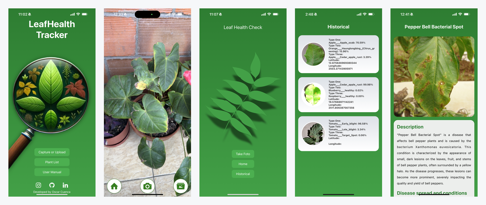

# LeafHealth Tracker 🌿

Mobile app that **detects plant leaf diseases from a photo**. Built with **React Native (Expo)** and **Firebase**, it
sends each image to [PhytoAnalytic Engine](https://github.com/CuencaOscar/PhytoAnalytic-Engine), a PyTorch ResNet9
model served through a Flask API, and keeps a geolocated history of every analysis.

Developed for my **Master's thesis in Web Applications and Services Development** at Universidad Internacional de
Valencia (VIU).




## Features

- Take a photo with the camera or pick one from the gallery.
- Top-3 diagnosis among 38 crop/condition pairs, with probabilities.
- History stored in Cloud Firestore with image, result, date and location.
- Disease catalogue with description, spread conditions and treatment.
- Built-in user manual.

## Architecture

```
Expo app ──► Firebase Storage (image) ──► PhytoAnalytic Engine /api ──► ResNet9
    │                                              │
    └──────────── Cloud Firestore (history) ◄──────┘
```

## Tech stack

React Native 0.72 · Expo SDK 49 · React Navigation · React Native Paper · Firebase (Firestore, Storage) ·
expo-camera · expo-image-picker · expo-location

## Getting started

Requirements: Node.js 18+, the Expo Go app or an emulator, a Firebase project with Firestore and Storage, and a
running instance of [PhytoAnalytic Engine](https://github.com/CuencaOscar/PhytoAnalytic-Engine).

```bash
npm install
cp .env.example .env    # fill in your Firebase web config and API URL
npx expo start
```

| Variable | Description |
|---|---|
| `EXPO_PUBLIC_FIREBASE_*` | Firebase web app configuration |
| `EXPO_PUBLIC_API_URL` | Classification endpoint, e.g. `https://your-host/api` |

Configuration lives in [`src/config.js`](src/config.js); no keys are stored in the repository. Protect your Firebase
project with Security Rules before publishing a build.

## Project structure

```
src/
├── components/   # Cards, buttons, skeleton loaders, footer
├── navigation/   # Stack navigator
├── screens/      # Home, camera, upload, history, catalogue, manual
├── resources/    # UI texts
├── styles/       # Colours, themes and shared styles
├── utils/        # User manual content
├── config.js     # Environment configuration
└── firebaseConfig.js
```

## License

MIT © Oscar Cuenca · [LinkedIn](https://www.linkedin.com/in/ocuenca-moreno/)
